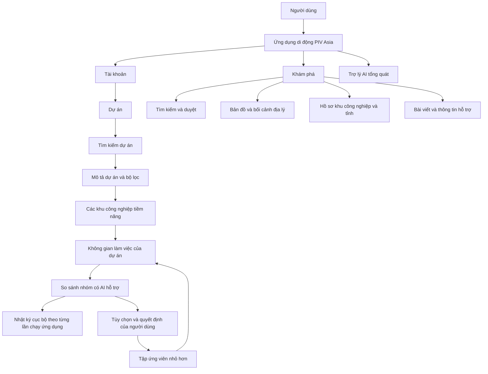
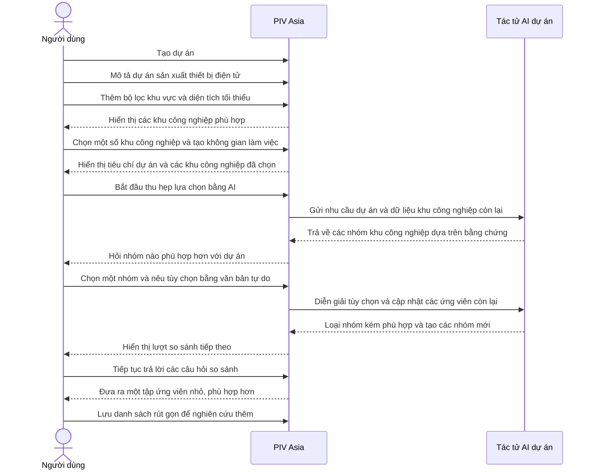
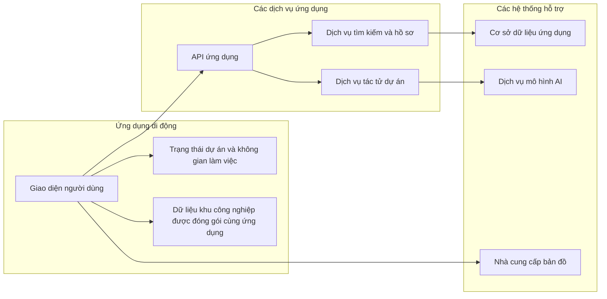
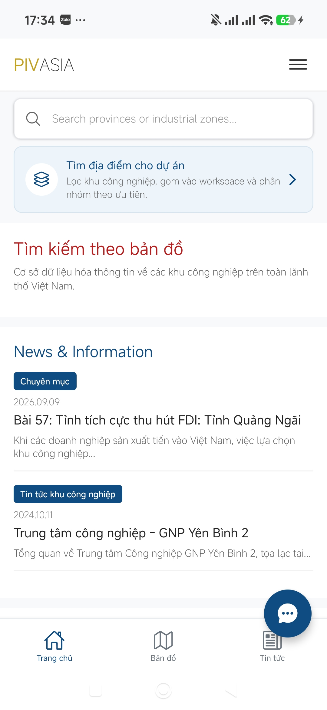
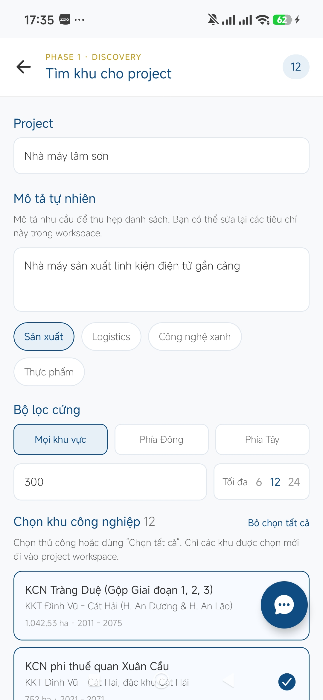
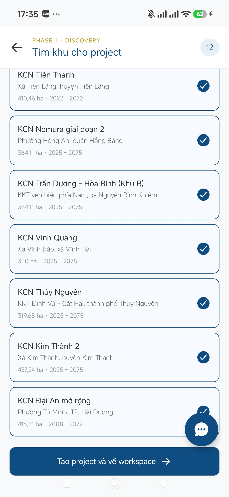
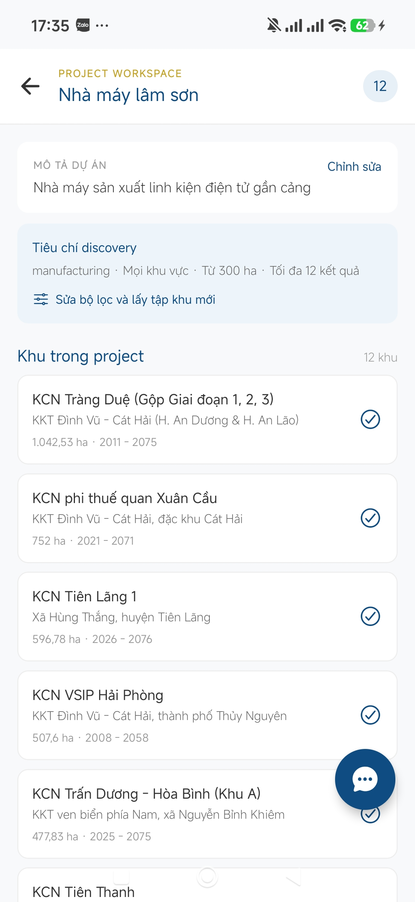
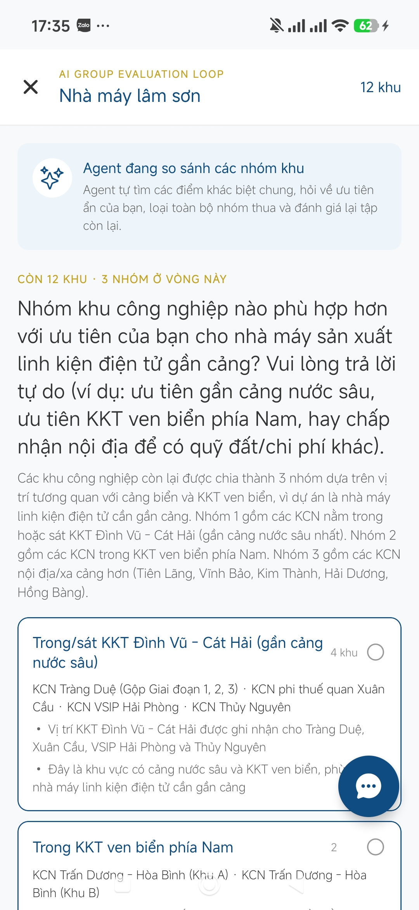
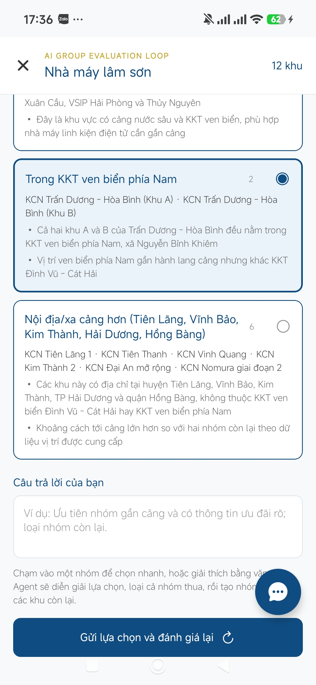

# Tổng quan thiết kế ứng dụng PIV Asia

## Cấu trúc sản phẩm cấp cao

## Các trải nghiệm chính của người dùng

### Khám phá

Trải nghiệm khám phá cung cấp cho người dùng nhiều cách để tìm hiểu bức tranh
toàn cảnh về các khu công nghiệp:

- Tìm kiếm địa điểm và các khu vực liên quan
- Duyệt thông tin địa lý trên bản đồ
- Mở hồ sơ khu công nghiệp và tỉnh
- Đọc các bài viết hỗ trợ và thông tin liên quan đến dự án

Những trải nghiệm này giúp người dùng tìm hiểu từng địa điểm riêng lẻ trước
khi tạo dự án hoặc không cần tạo dự án.

### Tìm kiếm dự án

Tìm kiếm dự án là bước khởi đầu cho một lượt tìm kiếm có mục tiêu. Người dùng
mô tả dự án bằng ngôn ngữ tự nhiên và có thể bổ sung các bộ lọc có cấu trúc
như vị trí, diện tích hoặc các yêu cầu khác.

Ứng dụng sử dụng những thông tin đầu vào đó để tạo danh sách ứng viên. Người
dùng có thể xem lại kết quả, chọn từng khu công nghiệp hoặc chọn tất cả kết
quả phù hợp. Các khu công nghiệp được chọn sau đó sẽ trở thành một phần của
không gian làm việc của dự án.

### Không gian làm việc của dự án

Không gian làm việc gắn với một dự án cụ thể của người dùng. Nơi đây tập hợp
mô tả dự án, tiêu chí tìm kiếm và các khu công nghiệp đã chọn.

Người dùng có thể quay lại tiêu chí tìm kiếm bất cứ lúc nào, chỉnh sửa tiêu
chí, tạo tập ứng viên mới và cập nhật không gian làm việc. Vì vậy, không gian
làm việc được thiết kế như một khu vực hỗ trợ ra quyết định có thể phát triển
theo thời gian, thay vì chỉ là một trang kết quả dùng một lần.

### Thu hẹp lựa chọn với AI hỗ trợ

Tính năng AI được thiết kế để giảm khối lượng so sánh thủ công mà người dùng
cần thực hiện.

Thay vì yêu cầu người dùng so sánh từng khu công nghiệp riêng lẻ, tác tử sẽ
tìm các nhóm khu công nghiệp có những đặc điểm quan trọng giống hoặc khác
nhau. Tác tử trình bày các nhóm đó, giải thích những bằng chứng hiện có trong
dữ liệu và yêu cầu người dùng nêu tùy chọn bằng văn bản tự do.

Phản hồi của người dùng được xem là tín hiệu về tùy chọn. Tác tử loại bỏ nhóm
không phù hợp với quyết định, đánh giá lại các khu công nghiệp còn lại và
tiếp tục vòng lặp cho đến khi tập ứng viên đủ hẹp.

AI có nhiệm vụ hỗ trợ phán đoán của người dùng, không thay thế việc xác minh
thông tin thương mại, pháp lý, thuế, cơ sở hạ tầng hoặc môi trường.

## Ví dụ về luồng tương tác của người dùng

Ví dụ sau minh họa trải nghiệm dự kiến. Đây không phải là kịch bản cố định;
các câu hỏi, nhóm và kết quả thực tế phụ thuộc vào dữ liệu dự án cũng như tùy
chọn của người dùng.

### Hướng dẫn từng bước

1. **Xác định dự án**  
   Người dùng tạo dự án có tên “Cơ sở lắp ráp thiết bị điện tử” và mô tả nhu
   cầu về nguồn tiện ích ổn định, khả năng tiếp cận cảng và đủ đất để mở rộng
   trong tương lai.

2. **Áp dụng tiêu chí tìm kiếm**  
   Người dùng chọn khu vực phù hợp và nhập yêu cầu diện tích tối thiểu. Ứng
   dụng trả về danh sách các khu công nghiệp có thể phù hợp.

3. **Tạo không gian làm việc**  
   Người dùng xem lại kết quả, chọn những khu công nghiệp có vẻ khả thi và
   tạo không gian làm việc cho dự án. Không gian làm việc hiển thị cùng lúc
   mô tả ban đầu, các bộ lọc và những khu công nghiệp đã chọn.

4. **Yêu cầu tác tử so sánh các nhóm**  
   Người dùng bắt đầu vòng lặp thu hẹp lựa chọn bằng AI. Tác tử xem xét các
   bằng chứng còn lại và phân nhóm khu công nghiệp, chẳng hạn:

   - Các khu có dấu hiệu thuận lợi hơn về cảng và logistics
   - Các khu có tiềm năng mở rộng lớn hơn
   - Các khu có ưu đãi rõ ràng hơn hoặc được ghi chép đầy đủ hơn

5. **Nêu tùy chọn**  
   Người dùng chọn nhóm có thông tin ưu đãi rõ ràng hơn và viết:

   > “Tôi ưu tiên nhóm có các lợi ích được ghi nhận rõ ràng, ngay cả khi giá
   > đất cao hơn một chút. Tôi vẫn cần khả năng tiếp cận cảng hợp lý.”

   Tác tử diễn giải đây là tùy chọn ưu tiên chất lượng bằng chứng, đồng thời
   xem khả năng tiếp cận cảng là yêu cầu thứ yếu. Tác tử loại nhóm không phù
   hợp với các ưu tiên đó và xây dựng lại phần so sánh dựa trên các khu công
   nghiệp còn lại.

6. **Tiếp tục vòng lặp**  
   Tác tử đưa ra lượt so sánh khác, chẳng hạn giữa nhóm có khả năng tiếp cận
   cảng tốt hơn và nhóm có nhiều không gian mở rộng hơn. Người dùng trả lời
   bằng lời của mình thay vì phải chọn theo một cây quyết định cố định.

7. **Tạo danh sách rút gọn thiết thực**  
   Sau vài vòng, dự án có thể còn ba hoặc bốn khu công nghiệp phù hợp nhất với
   các tùy chọn người dùng đã nêu và tác tử đã suy luận. Người dùng hài lòng
   với nhóm nhỏ hơn này và giữ lại trong không gian làm việc để xác minh chi
   tiết và nghiên cứu tiếp.

## Thiết kế hệ thống khái niệm

## Ranh giới dữ liệu và dịch vụ

- Ứng dụng di động quản lý giao diện người dùng và quy trình làm việc của dự
  án.
- Trạng thái dự án kết nối kết quả tìm kiếm với không gian làm việc của dự
  án.
- Thông tin khu công nghiệp có thể đến từ dữ liệu được đóng gói cùng ứng dụng
  hoặc từ các dịch vụ ứng dụng trong khi mô hình dữ liệu vẫn đang được hợp
  nhất.
- Máy chủ phụ trợ đóng vai trò ranh giới giữa ứng dụng khách và các dịch vụ
  bên ngoài.
- Các yêu cầu AI dự kiến sẽ đi qua máy chủ phụ trợ để thông tin xác thực và
  cấu hình riêng của dịch vụ không bị lộ trong ứng dụng di động.
- Tìm kiếm, hồ sơ, dữ liệu bản đồ và đánh giá bằng AI là các khả năng riêng
  biệt, dù cùng hỗ trợ hành trình ra quyết định tổng thể.

## Ảnh chụp màn hình

